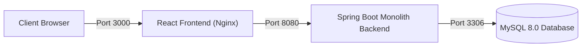
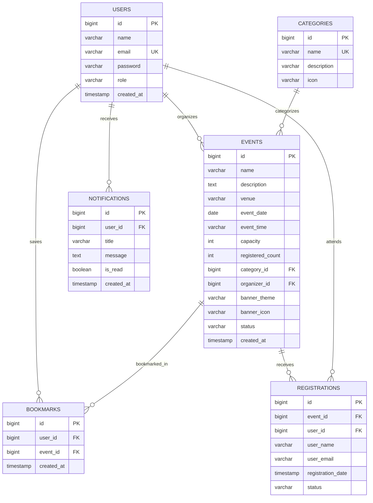

# EventEase — Modern Event Management Platform


---

## Table of Contents

- [1. Project Overview](#1-project-overview)
- [2. System Architecture](#2-system-architecture)
  - [2.1 Microservices Architecture (Primary)](#21-microservices-architecture-primary)
  - [2.2 Monolithic Architecture (Alternative)](#22-monolithic-architecture-alternative)
  - [2.3 Microservice Roster & Responsibilities](#23-microservice-roster--responsibilities)
- [3. Key Features](#3-key-features)
- [4. Database & Entity-Relationship Model](#4-database--entity-relationship-model)
  - [4.1 ER Diagram](#41-er-diagram)
  - [4.2 Database Tables & Design](#42-database-tables--design)
- [5. Concurrency & Security Architecture](#5-concurrency--security-architecture)
  - [5.1 Thread-Safe Seat Registration & Concurrency](#51-thread-safe-seat-registration--concurrency)
  - [5.2 Stateless JWT Authentication & RBAC](#52-stateless-jwt-authentication--rbac)
- [6. Directory & File Structure](#6-directory--file-structure)
- [7. Getting Started & Deployment Guide](#7-getting-started--deployment-guide)
  - [7.1 Prerequisites](#71-prerequisites)
  - [7.2 Environment Configuration](#72-environment-configuration)
  - [7.3 Mode A: Microservices Deployment (Docker Compose - Recommended)](#73-mode-a-microservices-deployment-docker-compose---recommended)
  - [7.4 Mode B: Monolithic Deployment (Docker Compose)](#74-mode-b-monolithic-deployment-docker-compose)
  - [7.5 Mode C: Bare-Metal Local Development (Without Docker)](#75-mode-c-bare-metal-local-development-without-docker)
- [8. Default Seed Accounts & Credentials](#8-default-seed-accounts--credentials)
- [9. API Documentation & Routing Matrix](#9-api-documentation--routing-matrix)
- [10. Testing & Verification](#10-testing--verification)
- [11. Troubleshooting & FAQ](#11-troubleshooting--faq)

---

## 1. Project Overview

**EventEase** is a scalable, full-stack enterprise Event Management Platform engineered to handle end-to-end event discovery, organization, attendee registration, bookmarking, capacity governance, and notifications.

Designed to demonstrate modern software engineering practices, EventEase supports **two architectural modalities**:
1. **Microservices Architecture (Default / Production)**: An event-driven, decoupled system composed of 4 dedicated Spring Boot microservices behind an **Nginx API Gateway**, a containerized **React 19 Single-Page Application (SPA)**, and an auto-seeded **MySQL 8.0** cluster.
2. **Monolithic Architecture**: A single unified Spring Boot application containing all domain modules, designed for lightweight environments or single-container deployments.

### Why EventEase?
- **High Concurrency Bookings**: Prevents overselling seats when multiple attendees attempt to register simultaneously using atomic SQL capacity verification and database-level constraints.
- **Role-Based Access Control (RBAC)**: Distinct permissions for standard attendees (`USER`) and event coordinators (`ADMIN`), protecting sensitive administrative dashboards and write operations.
- **Zero-Latency In-App Notification Center**: Keeps users updated about booking confirmations and platform updates with unread counter badges.
- **Turnkey Containerization**: Fully dockerized with automated database migrations, mock seed data, production Nginx reverse proxying, and health checks ready in a single command.

---

## 2. System Architecture

### 2.1 Microservices Architecture (Primary)

The application separates presentation, routing, core business domains, and persistence into isolated, independently scalable containers connected via an internal Docker bridge network (`eventease-network`).

```mermaid
flowchart TD
    subgraph ClientLayer ["Client Layer"]
        Browser["User Web Browser"]
    end

    subgraph PresentationLayer ["Frontend Container (:3000)"]
        ReactUI["React 19 / Vite SPA\n(Nginx Alpine)"]
    end

    subgraph GatewayLayer ["API Gateway (:8080)"]
        APIGateway["Nginx 1.27 Reverse Proxy\nRoute Dispatcher & CORS Handler"]
    end

    subgraph MicroservicesLayer ["Microservices Layer (Spring Boot / Java 17)"]
        UserService["User & Auth Service\n(:8081)"]
        EventService["Event & Category Service\n(:8082)"]
        RegService["Registration & Bookmark Service\n(:8083)"]
        NotifService["Notification Service\n(:8084)"]
    end

    subgraph DataLayer ["Data Layer (:3307 / :3306)"]
        MySQL[("MySQL 8.0 Database\n(event_management)")]
    end

    Browser -->|HTTP :3000| ReactUI
    ReactUI -->|REST API :8080| APIGateway

    APIGateway -->|/api/auth/*, /api/users/me| UserService
    APIGateway -->|/api/events/*, /api/categories/*, /api/admin/*| EventService
    APIGateway -->|/api/events/{id}/register*, /api/users/me/bookmarks| RegService
    APIGateway -->|/api/notifications/*| NotifService

    UserService -->|JDBC / HikariCP| MySQL
    EventService -->|JDBC / HikariCP| MySQL
    RegService -->|JDBC / HikariCP| MySQL
    NotifService -->|JDBC / HikariCP| MySQL
```

### 2.2 Monolithic Architecture (Alternative)

For environments where distributed microservices are unnecessary, EventEase can be launched as a consolidated monolith via [docker-compose.monolith.yml](file:///home/md_shemil/projects/fullstack-assignment/activity-4/event-management (2)/docker-compose.monolith.yml):



### 2.3 Microservice Roster & Responsibilities

| Container / Service | Host Port | Technology Stack | Core Domain Responsibilities |
| :--- | :--- | :--- | :--- |
| **`frontend`** | `3000` | React 19, Vite, Lucide Icons, Nginx Alpine | Responsive user interface, category filtering, search, registration modals, user dashboard, admin dashboard |
| **`api-gateway`** | `8080` | Nginx 1.27 Alpine | Unified API entry point, SSL termination point, path-based routing, CORS header injection, `/health` endpoint |
| **`user-service`** | `8081` | Spring Boot 4.x, Spring Security, JDBC | User registration, authentication, BCrypt hashing, JWT issuance & validation, user summaries |
| **`event-service`** | `8082` | Spring Boot 4.x, Spring Security, JDBC | Event catalog CRUD, category management, keyword search, capacity tracking, admin KPIs |
| **`registration-service`** | `8083` | Spring Boot 4.x, Spring Security, JDBC | Concurrency-safe event registration, duplicate booking prevention, user attendee lists, event bookmarking |
| **`notification-service`** | `8084` | Spring Boot 4.x, Spring Security, JDBC | User notification repository, read/unread status management, confirmation triggers |
| **`mysql-db`** | `3307` (`3306` internal) | MySQL 8.0 Community | Relational data persistence, foreign key enforcement, automatic initialization via entrypoint script |

---

## 3. Key Features

### For Attendees (`USER` Role)
- **Interactive Event Catalog**: Browse upcoming technology conferences, music festivals, design workshops, and summits with category filters and instant keyword search.
- **Real-Time Capacity Badges**: Visual capacity indicator bars showing live spots remaining and dynamic status flags (`UPCOMING`, `SOLD OUT`, `CANCELLED`).
- **Instant Seat Registration**: Single-click registration with participant confirmation modals.
- **Personal Booking Hub**: Dedicated modal to inspect personal registered events, view dates and venues, and cancel reservations if plans change.
- **Saved Bookmarks**: Bookmark events of interest to review them quickly without having to re-search.
- **In-App Notifications**: Real-time notifications for booking confirmations, platform announcements, and status updates.

### For Coordinators & Administrators (`ADMIN` Role)
- **Administrative KPI Dashboard**: Real-time operational metrics displaying total users, active events, aggregate registrations, and capacity utilization rate.
- **Event Management**: Create new events with customizable banner color themes (`purple`, `blue`, `pink`, `orange`, `green`, `yellow`), custom icons, venues, dates, and seat capacities.
- **Edit & Delete Events**: Modify event parameters or delete obsolete events with cascading cleanups.
- **Attendee Roster Inspection**: View complete attendee rosters (names, emails, registration timestamps) for any specific event.
- **User Management**: View all registered platform users and their assigned roles.

---

## 4. Database & Entity-Relationship Model

### 4.1 ER Diagram



### 4.2 Database Tables & Design

The relational schema is configured in [database/init.sql](file:///home/md_shemil/projects/fullstack-assignment/activity-4/event-management (2)/database/init.sql):

1. **`users`**: Manages credential storage, display names, and roles (`USER` or `ADMIN`).
   - Unique Index: `email`
2. **`categories`**: Groupings for events (e.g., *Technology*, *Music & Arts*, *Workshops*, *Business & Startups*).
   - Unique Index: `name`
3. **`events`**: Event listings with venue, schedule, seat capacity, `registered_count`, banner styling, and foreign keys referencing `categories` and `users` (organizer).
   - Indexes: `category_id`, `event_date`, `organizer_id`, `status`
4. **`registrations`**: Attendee bookings.
   - Unique Constraint: `(event_id, user_id)` preventing duplicate user registration for the same event.
   - Indexes: `event_id`, `user_id`, `user_email`, `status`
5. **`bookmarks`**: User-saved events.
   - Unique Constraint: `(user_id, event_id)` preventing duplicate bookmarks.
6. **`notifications`**: In-app notifications per user with `is_read` boolean flags.
   - Indexes: `user_id`, `is_read`

---

## 5. Concurrency & Security Architecture

### 5.1 Thread-Safe Seat Registration & Concurrency

Overselling tickets is a common race condition in high-demand event ticketing systems. EventEase mitigates this using multi-tiered concurrency controls:

1. **Atomic Capacity Check**: During registration, seat availability is evaluated using atomic SQL checks (`registered_count < capacity`).
2. **Transactional Increments & Rollbacks**: Registrations run in an isolated database transaction. If the booking succeeds, `registered_count` increments atomically. If the capacity is exceeded, an `EventFullException` is thrown and the transaction rolls back.
3. **Duplicate Prevention**: The compound unique constraint `CONSTRAINT uk_registrations_event_user UNIQUE (event_id, user_id)` guarantees at the database level that simultaneous requests from the same user cannot create twin registrations.
4. **Stress Testing**: Verified via multithreaded test suite ([ConcurrentRegistrationTest.java](file:///home/md_shemil/projects/fullstack-assignment/activity-4/event-management (2)/event-management/src/test/java/com/eventease/service/ConcurrentRegistrationTest.java)) where 50 threads compete for 10 seats simultaneously; the system strictly permits 10 registrations and rejects 40 without data corruption.

### 5.2 Stateless JWT Authentication & RBAC

1. **Password Encryption**: All passwords stored in MySQL are hashed using **BCrypt** with salt work factor 10.
2. **Stateless Tokens**: On successful authentication (`POST /api/auth/login`), the `user-service` issues an HMAC-SHA256 signed JSON Web Token (JWT) encapsulating `sub` (email), `userId`, `role`, and `name`.
3. **Inter-Service Token Validation**: Each microservice shares the symmetrical secret key (`APP_JWT_SECRET`) provided by Docker environment variables. When a request traverses the API Gateway with `Authorization: Bearer <token>`, downstream services validate the signature locally without requiring inter-service REST calls back to `user-service`.

---

## 6. Directory & File Structure

```
event-management/
├── docker-compose.yml              # Primary Microservices Docker orchestration
├── docker-compose.monolith.yml     # Standalone Monolith Docker orchestration
├── .env.example                    # Environment variable configuration template
├── .env                            # Active environment configuration (git-ignored)
├── .dockerignore                   # Build context exclusions
├── DOCKER_MICROSERVICES_GUIDE.md   # Architectural reference guide
├── README.md                       # Master documentation
├── index.html                      # Standalone static UI preview
│
├── api-gateway/                    # Nginx API Gateway container
│   ├── Dockerfile                  # Lightweight Nginx Alpine image
│   └── nginx.conf                  # Upstream routing, proxy buffering, CORS config
│
├── database/                       # Database initialization
│   └── init.sql                    # Auto-mounted MySQL bootstrap (Schema + Seed DML)
│
├── eventease-frontend/             # React 19 Single Page Application
│   ├── Dockerfile                  # Production multi-stage Nginx runner
│   ├── nginx.conf                  # SPA fallback routing & gzip caching
│   ├── package.json                # Frontend dependencies (React 19, Lucide, Vite)
│   ├── vite.config.js              # Vite configuration
│   └── src/
│       ├── App.jsx                 # Main state coordinator & view router
│       ├── App.css                 # Platform styles, design tokens & responsive CSS
│       ├── components/             # Reusable UI component library
│       │   ├── Navbar.jsx          # Top navigation, notifications bell, user menu
│       │   ├── Hero.jsx            # Search bar & hero banner
│       │   ├── CategoryFilter.jsx  # Interactive category pills
│       │   ├── EventCard.jsx       # Individual event card with capacity bar
│       │   ├── EventDetailsModal.jsx # Detailed event specification
│       │   ├── RegisterModal.jsx   # Booking submission modal
│       │   ├── AdminDashboardModal.jsx # Administrative analytics & event management
│       │   ├── CreateEventModal.jsx # Event creation & modification modal
│       │   ├── RegistrationsModal.jsx # Admin attendee list viewer
│       │   ├── UserRegistrationsModal.jsx # Attendee's personal booking & bookmark manager
│       │   ├── AuthModal.jsx       # Sign In & Sign Up modal
│       │   ├── Toast.jsx           # Real-time alert notifications
│       │   └── LoadingSpinner.jsx  # Loading indicator
│       ├── context/
│       │   └── AuthContext.jsx     # User authentication state provider
│       └── services/
│           ├── api.js              # Centralized fetch client with JWT interceptor
│           ├── authService.js      # Auth API endpoints
│           ├── eventService.js     # Event and category API endpoints
│           ├── userService.js      # User management API endpoints
│           └── adminService.js     # Admin dashboard API endpoints
│
├── event-management/               # Spring Boot Monolithic Backend
│   ├── pom.xml                     # Maven project definition (Java 17, Spring Boot 4)
│   ├── Dockerfile                  # Temurin 17 JRE container
│   ├── src/main/java/com/eventease/
│   │   ├── EventManagementApplication.java # Spring Boot entrypoint
│   │   ├── config/                 # Security & data initialization configs
│   │   ├── controller/             # REST API controllers
│   │   ├── dto/                    # Request and Response payloads
│   │   ├── exception/              # Global exception handlers
│   │   ├── model/                  # Domain entities (User, Event, Registration, etc.)
│   │   ├── repository/             # Spring JDBC repositories & SQL queries
│   │   ├── security/               # JWT token provider & security filter chain
│   │   └── service/                # Business logic services
│   └── src/test/                   # Concurrency and integration tests
│
└── services/                       # Decoupled Spring Boot Microservices
    ├── user-service/               # User registration, auth & profile service (:8081)
    ├── event-service/              # Event CRUD, categories & admin metrics (:8082)
    ├── registration-service/       # Seat bookings & user bookmarks (:8083)
    └── notification-service/       # In-app notifications & alerts (:8084)
```

---

## 7. Getting Started & Deployment Guide

### 7.1 Prerequisites

Ensure you have the following installed on your host system:
- [Docker](https://docs.docker.com/get-docker/) (v24.0 or newer)
- [Docker Compose](https://docs.docker.com/compose/) (v2.20 or newer)
- *(Optional for bare-metal local development)*: Java JDK 17+, Maven 3.8+, Node.js 18+, MySQL 8.0

---

### 7.2 Environment Configuration

Create your local `.env` file from the provided template:

```bash
cp .env.example .env
```

Review or adjust the variables inside `.env` if desired:

```env
# Database Credentials
MYSQL_DATABASE=event_management
MYSQL_USER=eventease
MYSQL_PASSWORD=EventEase@2026
MYSQL_ROOT_PASSWORD=RootPassword@2026

# Security / Symmetrical JWT Secret Key (HMAC-SHA256)
APP_JWT_SECRET=EventEaseSuperSecretSecurityKey2026WithSufficientLengthForHMACSHA256SignatureVerification
APP_JWT_EXPIRATION_MS=86400000

# Port Mapping
GATEWAY_PORT=8080
FRONTEND_PORT=3000
MYSQL_PORT=3307
USER_SERVICE_PORT=8081
EVENT_SERVICE_PORT=8082
REGISTRATION_SERVICE_PORT=8083
NOTIFICATION_SERVICE_PORT=8084
```

---

### 7.3 Mode A: Microservices Deployment (Docker Compose - Recommended)

This mode builds and starts all 7 microservice containers:

```bash
# 1. Build and start all microservices in detached mode
docker compose up -d --build

# 2. Monitor status and health of all containers
docker compose ps
```

Once running, access the services:
- **Frontend Web UI**: [http://localhost:3000](http://localhost:3000)
- **API Gateway**: [http://localhost:8080](http://localhost:8080)
- **API Health Check**: [http://localhost:8080/health](http://localhost:8080/health)
- **MySQL Database**: `localhost:3307` (Credentials: `eventease` / `EventEase@2026`)

#### Inspecting Logs
```bash
# View combined logs
docker compose logs -f

# Tail a specific microservice
docker compose logs -f user-service
docker compose logs -f event-service
docker compose logs -f registration-service
docker compose logs -f notification-service
docker compose logs -f api-gateway
```

#### Stopping the Stack
```bash
# Stop containers (preserves database data)
docker compose down

# Stop and wipe database volume for a clean reset
docker compose down -v
```

---

### 7.4 Mode B: Monolithic Deployment (Docker Compose)

If you wish to run the entire backend as a single container along with the frontend and database:

```bash
# Launch the 3-container monolithic stack
docker compose -f docker-compose.monolith.yml up -d --build

# Verify running services
docker compose -f docker-compose.monolith.yml ps

# Shutdown
docker compose -f docker-compose.monolith.yml down
```

---

### 7.5 Mode C: Bare-Metal Local Development (Without Docker)

To run the application locally on your machine for debugging or rapid code changes:

#### Step 1: Start MySQL Database
Ensure a local MySQL 8.0 server is running on port `3306`:
```bash
mysql -u root -p < database/init.sql
```

#### Step 2: Run the Spring Boot Backend
In the `event-management/` directory:
```bash
cd event-management
./mvnw clean spring-boot:run
```
*The monolithic backend will start on [http://localhost:8080](http://localhost:8080).*

#### Step 3: Run the React Frontend
In the `eventease-frontend/` directory:
```bash
cd eventease-frontend
npm install
npm run dev
```
*The Vite development server will start on [http://localhost:5173](http://localhost:5173) or [http://localhost:3000](http://localhost:3000).*

---

## 8. Default Seed Accounts & Credentials

The database is pre-populated on startup with sample users and events:

| Name | Email Address | Password | Role | Permissions |
| :--- | :--- | :--- | :--- | :--- |
| **EventEase Admin** | `admin@eventease.com` | `admin123` | **`ADMIN`** | Full access: View analytics dashboard, create/edit/delete events, inspect attendee rosters, manage users |
| **John Doe** | `john@example.com` | `password123` | **`USER`** | Standard access: Browse events, register for sessions, manage bookmarks, receive notifications |
| **Sarah Connor** | `sarah@example.com` | `password123` | **`USER`** | Standard access: Browse events, register for sessions, manage bookmarks, receive notifications |

> [!TIP]
> You can also register brand-new accounts directly through the **Sign Up** tab in the web UI. Newly registered users receive the standard `USER` role.

---

## 9. API Documentation & Routing Matrix

All external client traffic routes through the **API Gateway** on port `8080`. The table below outlines how requests are dispatched to downstream services:

| HTTP Method | API Route Pattern | Dispatched Upstream Service | Auth Required | Description |
| :--- | :--- | :--- | :---: | :--- |
| `GET` | `/health` | *API Gateway directly* | No | Gateway operational status check |
| `POST` | `/api/auth/register` | `user-service:8081` | No | Register new user account |
| `POST` | `/api/auth/login` | `user-service:8081` | No | Authenticate user & return signed JWT |
| `GET` | `/api/users/me` | `user-service:8081` | Yes | Get currently authenticated user profile |
| `GET` | `/api/admin/users` | `user-service:8081` | Yes (`ADMIN`) | List all registered users |
| `GET` | `/api/users/count` | `user-service:8081` | Yes (`ADMIN`) | Total registered user count |
| `GET` | `/api/categories` | `event-service:8082` | No | List all event categories |
| `GET` | `/api/events` | `event-service:8082` | No | Search & filter events (`?category=&search=`) |
| `GET` | `/api/events/{id}` | `event-service:8082` | No | Get event details by ID |
| `POST` | `/api/events` | `event-service:8082` | Yes (`ADMIN`) | Create new event listing |
| `PUT` | `/api/events/{id}` | `event-service:8082` | Yes (`ADMIN`) | Update existing event listing |
| `DELETE` | `/api/events/{id}` | `event-service:8082` | Yes (`ADMIN`) | Delete event listing |
| `GET` | `/api/admin/dashboard` | `event-service:8082` | Yes (`ADMIN`) | Retrieve high-level operational statistics |
| `POST` | `/api/events/{id}/register` | `registration-service:8083` | Yes | Register authenticated user for an event |
| `DELETE` | `/api/events/{id}/register` | `registration-service:8083` | Yes | Cancel event registration |
| `GET` | `/api/events/{id}/registrations` | `registration-service:8083` | Yes (`ADMIN`) | Retrieve attendee roster for an event |
| `GET` | `/api/users/me/registrations` | `registration-service:8083` | Yes | List events attended by current user |
| `POST` | `/api/events/{id}/bookmark` | `registration-service:8083` | Yes | Add event to personal bookmarks |
| `DELETE` | `/api/events/{id}/bookmark` | `registration-service:8083` | Yes | Remove event from personal bookmarks |
| `GET` | `/api/users/me/bookmarks` | `registration-service:8083` | Yes | List bookmarked events for current user |
| `GET` | `/api/notifications` | `notification-service:8084` | Yes | Fetch user notification feed |
| `PUT` | `/api/notifications/{id}/read` | `notification-service:8084` | Yes | Mark specific notification as read |

---

## 10. Testing & Verification

### Running Automated Backend Tests
Unit and integration tests (including the concurrent booking test suite) can be executed using Maven:

```bash
cd event-management
./mvnw test
```

### Verifying Service Health via cURL
Test running services through the API Gateway:

```bash
# 1. API Gateway Health
curl -s http://localhost:8080/health
# Response: {"status":"UP","service":"EventEase API Gateway"}

# 2. Public Events Endpoint
curl -s http://localhost:8080/api/events | jq .

# 3. Categories Endpoint
curl -s http://localhost:8080/api/categories | jq .

# 4. User Login & JWT Extraction
curl -s -X POST http://localhost:8080/api/auth/login \
  -H "Content-Type: application/json" \
  -d '{"email":"admin@eventease.com","password":"admin123"}' | jq .
```

---

## 11. Troubleshooting & FAQ

### Port Conflicts
- **Problem**: Error `Bind for 0.0.0.0:8080 failed: port is already allocated`.
- **Solution**: Check if another local web server or proxy is occupying the port (`sudo lsof -i :8080`). You can customize any port in your `.env` file (e.g., change `GATEWAY_PORT=8085`).

### Database Health Check Retries
- **Problem**: Microservice containers wait or restart while MySQL initializes.
- **Explanation**: MySQL requires ~15-25 seconds on first boot to run `database/init.sql`. The microservices use `depends_on: mysql-db: condition: service_healthy` to ensure they do not attempt database connections before MySQL is fully ready.

### Database Reset / Re-seed
- **Problem**: You want to wipe all records and restore default seed data.
- **Solution**:
  ```bash
  docker compose down -v
  docker compose up -d
  ```

---

## License

This project is licensed for educational and assessment purposes as part of the Fullstack Development Assignment. All rights reserved.
