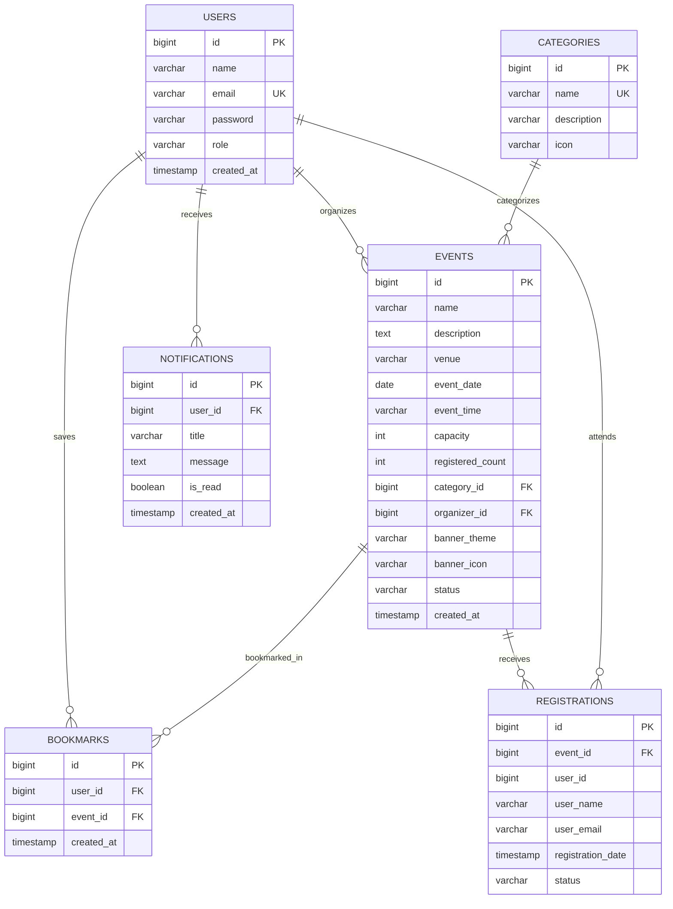

# EventEase Database Setup & SQL Commands Reference Guide

This document records **all commands and steps** used to design, create, configure, seed, verify, and maintain the relational SQL database for the EventEase Event Management application, as well as the JDBC integration details.

---

## 1. System Architecture & Entity-Relationship Model



---

## 2. Server Installation & Service Management Commands

### Install MySQL Server on Ubuntu/Debian Linux
```bash
sudo apt update
sudo apt install -y mysql-server
```

### Start & Check Service Status
```bash
# Start MySQL daemon
sudo service mysql start
# or via systemd:
sudo systemctl start mysql

# Verify running status
sudo service mysql status
# or:
sudo systemctl status mysql

# Enable startup on system boot
sudo systemctl enable mysql
```

---

## 3. Database & User Provisioning Commands

Connect to MySQL as administrative root:
```bash
sudo mysql -u root
```

Execute the following SQL commands:

```sql
-- 1. Create dedicated database with UTF-8 support
CREATE DATABASE IF NOT EXISTS event_management
    CHARACTER SET utf8mb4
    COLLATE utf8mb4_unicode_ci;

-- 2. Create application user with secure authentication
CREATE USER IF NOT EXISTS 'eventease'@'localhost' IDENTIFIED BY 'EventEase@2026';
CREATE USER IF NOT EXISTS 'eventease'@'%' IDENTIFIED BY 'EventEase@2026';

-- 3. Grant full privileges on the database to the application user
GRANT ALL PRIVILEGES ON event_management.* TO 'eventease'@'localhost';
GRANT ALL PRIVILEGES ON event_management.* TO 'eventease'@'%';

-- 4. Reload privilege tables
FLUSH PRIVILEGES;

-- 5. Confirm databases and user permissions
SHOW DATABASES;
SHOW GRANTS FOR 'eventease'@'localhost';
```

---

## 4. Schema Creation (DDL Commands)

You can run the schema file directly from bash:
```bash
mysql -u eventease -pEventEase@2026 event_management < database/schema.sql
```

Or execute interactively in MySQL CLI:
```sql
USE event_management;

-- 1. Users Table
CREATE TABLE IF NOT EXISTS users (
    id BIGINT AUTO_INCREMENT PRIMARY KEY,
    name VARCHAR(100) NOT NULL,
    email VARCHAR(150) NOT NULL,
    password VARCHAR(255) NOT NULL,
    role VARCHAR(20) NOT NULL DEFAULT 'USER',
    created_at TIMESTAMP NOT NULL DEFAULT CURRENT_TIMESTAMP,
    CONSTRAINT uk_users_email UNIQUE (email)
) ENGINE=InnoDB DEFAULT CHARSET=utf8mb4 COLLATE=utf8mb4_unicode_ci;

-- 2. Categories Table
CREATE TABLE IF NOT EXISTS categories (
    id BIGINT AUTO_INCREMENT PRIMARY KEY,
    name VARCHAR(100) NOT NULL,
    description VARCHAR(500),
    icon VARCHAR(50),
    CONSTRAINT uk_categories_name UNIQUE (name)
) ENGINE=InnoDB DEFAULT CHARSET=utf8mb4 COLLATE=utf8mb4_unicode_ci;

-- 3. Events Table
CREATE TABLE IF NOT EXISTS events (
    id BIGINT AUTO_INCREMENT PRIMARY KEY,
    name VARCHAR(200) NOT NULL,
    description TEXT,
    venue VARCHAR(255) NOT NULL,
    event_date DATE NOT NULL,
    event_time VARCHAR(50) NOT NULL DEFAULT '10:00 AM',
    capacity INT NOT NULL,
    registered_count INT NOT NULL DEFAULT 0,
    category_id BIGINT,
    organizer_id BIGINT,
    banner_theme VARCHAR(50) DEFAULT 'purple',
    banner_icon VARCHAR(50) DEFAULT '✦',
    status VARCHAR(20) NOT NULL DEFAULT 'UPCOMING',
    created_at TIMESTAMP NOT NULL DEFAULT CURRENT_TIMESTAMP,
    CONSTRAINT fk_events_category FOREIGN KEY (category_id) REFERENCES categories(id) ON DELETE SET NULL,
    CONSTRAINT fk_events_organizer FOREIGN KEY (organizer_id) REFERENCES users(id) ON DELETE SET NULL,
    INDEX idx_events_category (category_id),
    INDEX idx_events_date (event_date),
    INDEX idx_events_organizer (organizer_id),
    INDEX idx_events_status (status)
) ENGINE=InnoDB DEFAULT CHARSET=utf8mb4 COLLATE=utf8mb4_unicode_ci;

-- 4. Registrations Table
CREATE TABLE IF NOT EXISTS registrations (
    id BIGINT AUTO_INCREMENT PRIMARY KEY,
    event_id BIGINT NOT NULL,
    user_id BIGINT,
    user_name VARCHAR(100) NOT NULL,
    user_email VARCHAR(150) NOT NULL,
    registration_date TIMESTAMP NOT NULL DEFAULT CURRENT_TIMESTAMP,
    status VARCHAR(20) NOT NULL DEFAULT 'CONFIRMED',
    CONSTRAINT fk_registrations_event FOREIGN KEY (event_id) REFERENCES events(id) ON DELETE CASCADE,
    CONSTRAINT uk_registrations_event_user UNIQUE (event_id, user_id),
    INDEX idx_registrations_event (event_id),
    INDEX idx_registrations_user (user_id),
    INDEX idx_registrations_email (user_email),
    INDEX idx_registrations_status (status)
) ENGINE=InnoDB DEFAULT CHARSET=utf8mb4 COLLATE=utf8mb4_unicode_ci;

-- 5. Bookmarks Table
CREATE TABLE IF NOT EXISTS bookmarks (
    id BIGINT AUTO_INCREMENT PRIMARY KEY,
    user_id BIGINT NOT NULL,
    event_id BIGINT NOT NULL,
    created_at TIMESTAMP NOT NULL DEFAULT CURRENT_TIMESTAMP,
    CONSTRAINT fk_bookmarks_user FOREIGN KEY (user_id) REFERENCES users(id) ON DELETE CASCADE,
    CONSTRAINT fk_bookmarks_event FOREIGN KEY (event_id) REFERENCES events(id) ON DELETE CASCADE,
    CONSTRAINT uk_bookmarks_user_event UNIQUE (user_id, event_id),
    INDEX idx_bookmarks_user (user_id),
    INDEX idx_bookmarks_event (event_id)
) ENGINE=InnoDB DEFAULT CHARSET=utf8mb4 COLLATE=utf8mb4_unicode_ci;

-- 6. Notifications Table
CREATE TABLE IF NOT EXISTS notifications (
    id BIGINT AUTO_INCREMENT PRIMARY KEY,
    user_id BIGINT NOT NULL,
    title VARCHAR(200) NOT NULL,
    message TEXT NOT NULL,
    is_read BOOLEAN NOT NULL DEFAULT FALSE,
    created_at TIMESTAMP NOT NULL DEFAULT CURRENT_TIMESTAMP,
    INDEX idx_notifications_user (user_id),
    INDEX idx_notifications_read (is_read)
) ENGINE=InnoDB DEFAULT CHARSET=utf8mb4 COLLATE=utf8mb4_unicode_ci;
```

---

## 5. Seed Data Population (DML Commands)

Run the seed script from terminal:
```bash
mysql -u eventease -pEventEase@2026 event_management < database/seed.sql
```

Or run all-in-one bootstrap with `database/setup.sql`:
```bash
mysql -u root -p < database/setup.sql
```

The seed script initializes:
1. **Users**:
   - `admin@eventease.com` (Role: `ADMIN`, Password: `admin123`)
   - `john@example.com` (Role: `USER`, Password: `password123`)
   - `sarah@example.com` (Role: `USER`, Password: `password123`)
2. **Categories**: Technology, Music & Arts, Workshops, Business & Startups, Design & Creative, Conferences & Talks.
3. **Events**: 6 rich events scheduled with dates, venues, capacities, themes, and icons.
4. **Registrations**: Pre-registered attendees for upcoming events.
5. **Bookmarks**: Saved events for quick user retrieval.
6. **Notifications**: System announcements and confirmation notifications.

---

## 6. Verification and Inspection Queries

Run these verification commands in `mysql`:

```sql
USE event_management;

-- List all tables
SHOW TABLES;

-- Inspect table structures
DESCRIBE users;
DESCRIBE events;
DESCRIBE registrations;

-- Check total row counts across all tables
SELECT 'users' AS table_name, count(*) AS count FROM users
UNION ALL
SELECT 'categories', count(*) FROM categories
UNION ALL
SELECT 'events', count(*) FROM events
UNION ALL
SELECT 'registrations', count(*) FROM registrations
UNION ALL
SELECT 'bookmarks', count(*) FROM bookmarks
UNION ALL
SELECT 'notifications', count(*) FROM notifications;

-- Inspect events with category details
SELECT 
    e.id, 
    e.name, 
    c.name AS category, 
    e.venue, 
    e.event_date, 
    e.capacity, 
    e.registered_count,
    (e.capacity - e.registered_count) AS spots_left,
    e.status
FROM events e
LEFT JOIN categories c ON e.category_id = c.id;

-- Inspect registrations with attendee details
SELECT 
    r.id AS reg_id, 
    e.name AS event_title, 
    r.user_name, 
    r.user_email, 
    r.status, 
    r.registration_date 
FROM registrations r
JOIN events e ON r.event_id = e.id
ORDER BY r.registration_date DESC;
```

---

## 7. Database Backup & Restore Commands

### Create a Complete Database Backup (Logical Dump)
```bash
mysqldump -u eventease -pEventEase@2026 \
    --routines --triggers --single-transaction \
    event_management > event_management_backup.sql
```

### Restore from Backup File
```bash
mysql -u eventease -pEventEase@2026 event_management < event_management_backup.sql
```

---

## 8. JDBC Integration in Spring Boot

### 8.1 Maven Dependencies (`pom.xml`)
The backend project includes:
```xml
<!-- Spring Boot JDBC Starter (JdbcTemplate, DataSource, HikariCP) -->
<dependency>
    <groupId>org.springframework.boot</groupId>
    <artifactId>spring-boot-starter-jdbc</artifactId>
</dependency>

<!-- MySQL Connector/J -->
<dependency>
    <groupId>com.mysql</groupId>
    <artifactId>mysql-connector-j</artifactId>
    <version>8.3.0</version>
    <scope>runtime</scope>
</dependency>

<!-- H2 Database for Zero-Config Local & Automated Testing -->
<dependency>
    <groupId>com.h2database</groupId>
    <artifactId>h2</artifactId>
    <scope>runtime</scope>
</dependency>
```

### 8.2 Application Properties Configuration

#### Default In-Memory / H2 Mode (`src/main/resources/application.properties`):
```properties
spring.datasource.url=jdbc:h2:mem:event_management;MODE=MySQL;DATABASE_TO_LOWER=TRUE;DB_CLOSE_DELAY=-1
spring.datasource.driver-class-name=org.h2.Driver
spring.datasource.username=sa
spring.datasource.password=
spring.sql.init.mode=always
spring.sql.init.schema-locations=classpath:schema.sql
spring.h2.console.enabled=true
```

#### MySQL Production Profile (`src/main/resources/application-mysql.properties`):
```properties
spring.datasource.url=jdbc:mysql://localhost:3306/event_management?useSSL=false&serverTimezone=UTC&allowPublicKeyRetrieval=true&characterEncoding=UTF-8
spring.datasource.driver-class-name=com.mysql.cj.jdbc.Driver
spring.datasource.username=eventease
spring.datasource.password=EventEase@2026

# HikariCP Connection Pool
spring.datasource.hikari.maximum-pool-size=10
spring.datasource.hikari.minimum-idle=5
spring.datasource.hikari.idle-timeout=300000
spring.datasource.hikari.connection-timeout=20000

spring.sql.init.mode=always
spring.sql.init.schema-locations=classpath:schema.sql
```

### 8.3 Switching Environments at Runtime

- **Default (Embedded H2)**:
  ```bash
  cd event-management
  ./mvnw spring-boot:run
  ```

- **MySQL Production Database**:
  ```bash
  cd event-management
  ./mvnw spring-boot:run -Dspring-boot.run.profiles=mysql
  ```
  *(Or execute jar with `--spring.profiles.active=mysql`)*

### 8.4 JDBC Repositories Architecture
All repository interfaces are implemented with Spring `JdbcTemplate` and annotated with `@Repository @Primary`:
1. `JdbcUserRepository` (`com.eventease.repository.JdbcUserRepository`)
2. `JdbcCategoryRepository` (`com.eventease.repository.JdbcCategoryRepository`)
3. `JdbcEventRepository` (`com.eventease.repository.JdbcEventRepository`)
4. `JdbcRegistrationRepository` (`com.eventease.repository.JdbcRegistrationRepository`)
5. `JdbcBookmarkRepository` (`com.eventease.repository.JdbcBookmarkRepository`)
6. `JdbcNotificationRepository` (`com.eventease.repository.JdbcNotificationRepository`)
